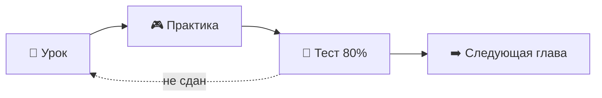

<div align="center">

# 🎯 SA Quest

### Тренажёр системного аналитика: от нуля до оффера джуна

**Урок → практика → тест** в каждой главе, симулятор собеседования и сквозные кейсы.
Требования, BPMN, UML, ER, SQL, REST API — на реальных заданиях, а не на заучивании.

[](https://hpainh.github.io/sa-quest/)


</div>

---

## 📌 Слайд 1. Что это

Интерактивное веб-приложение по авторской методичке «Системный аналитик: подготовка к трудоустройству в РФ».
Без установки, регистрации и сервера: открывается в браузере, прогресс хранится локально и переносится кодом сохранения.

Серия: ML Quest · Algo Quest · Math Quest · Python Quest · SQL Quest · **SA Quest**

---

## 📊 Слайд 2. В цифрах

| 📚 Глав | 📖 Разделов теории | 🎮 Практических заданий | ✅ Всего проверяемых заданий | 💼 Кейсов |
|:---:|:---:|:---:|:---:|:---:|
| **25** | **161** | **328** | **735** | **2** |

| 🗺️ Диаграмм | 🃏 Карточек | 📘 Терминов | 📋 Шпаргалок | 🏆 Достижений |
|:---:|:---:|:---:|:---:|:---:|
| **16** | **117** | **80** | **8** | **22** |

---

## 🧭 Слайд 3. Как устроена глава



- **Урок**: оглавление, прогресс чтения, разборы артефактов, блоки «Пример», «Ловушка», «На собеседовании», проверка себя
- **Практика**: подсказки, разбор каждой ошибки, XP за самостоятельное решение
- **Тест**: без подсказок, порог 80%, бонус за первую сдачу

---

## 🗂️ Слайд 4. Программа

| Часть | Темы |
|---|---|
| **I. Введение** | роль аналитика, путь задачи от запроса до релиза, грейды, план на 12 недель |
| **II. Требования** | SDLC, ГОСТ Р 59793-2021 и ГОСТ 34.602-2020, интервью и протоколы, RACI, НФТ в цифрах, user story, Gherkin, use case, спецификация функции |
| **III. Моделирование** | BPMN с формальными правилами и правилами стиля, UML sequence и состояния, ER и нормализация |
| **IV. Данные** | транзакции и уровни изоляции, ограничения и типы, SQL от SELECT до CTE и оконных функций |
| **V. Интеграции** | монолит и микросервисы, C4, REST, идемпотентность, ETag, коды 401/403/409/415/429, брокеры, outbox |
| **VI. Инструменты** | OpenAPI, Postman, трекеры, база знаний, Scrum и Kanban, метрики потока |
| **VII. ИИ** | промптинг, ограничения LLM, сценарии работы аналитика с ИИ, проверка результата |
| **VIII. Карьера** | pet-проект, резюме до/после, сопроводительное письмо, собеседование, тестовое задание, оффер |

---

## 🎤 Слайд 5. Симулятор собеседования

1. Выбираете тему, число вопросов и время на ответ
2. Отвечаете вслух или тезисами, пока идёт таймер
3. Сравниваете с эталонным ответом и оцениваете себя
4. Получаете отчёт по темам и список глав для повторения

Оценки синхронизируются с карточками интервального повторения.

---

## 💼 Слайд 6. Сквозные кейсы

| Кейс | Этапы |
|---|---|
| **Самостоятельная отмена заказа** | стейкхолдеры → вопросы → требования → BPMN → состояния → user story → проверка API → метрика в SQL |
| **Онлайн-запись к врачу** | цель → use case → BPMN → ER → API → НФТ → ревью требований |

После каждого этапа показывается решение опытного аналитика.

---

## 🧩 Слайд 7. Типы заданий

| Тип | Что делаете |
|---|---|
| 🔘 Выбор, мультивыбор, верно/неверно | проверяете понимание |
| 🗃️ Классификация, порядок, соответствие | раскладываете и упорядочиваете |
| ✍️ Пропуски, поиск ошибок в тексте | находите неточности |
| 🧪 **SQL** | пишете запросы к базе магазина прямо в браузере |
| 🔌 **API** | шлёте запросы на тренировочный REST-сервер |
| 🖼️ **Ошибки на диаграмме** | кликаете по неверным элементам BPMN, UML, ER |
| 🧷 **Пропуски на диаграмме** | восстанавливаете подписи и кардинальность |
| 🧾 **Ошибки в коде** | HTTP, JSON, YAML, Postman, curl |
| 📝 Свободный ответ | пишете, проверка идёт по правилам |

---

## 🗺️ Слайд 8. Диаграммы по правилам нотации

Собственный SVG-движок: BPMN с пулами и дорожками, sequence, ER, состояния, activity, архитектура, Kafka.

Эталонные диаграммы автоматически проверяются (`SAQ.dg.lint`):

- поток идёт слева направо: выход справа, вход слева
- у начала нет входящих, у конца нет исходящих, нет висящих элементов
- ветки XOR подписаны, ветки AND не подписаны
- между пулами только потоки сообщений с именем

---

## 🔌 Слайд 9. Тренировочный REST-сервер

| Что отрабатываете | Как |
|---|---|
| Аутентификация | `POST /login` → Bearer-токен |
| 401 и 403 | `readonly-token` разрешает только GET |
| Идемпотентность | `Idempotency-Key` → повтор вернёт 200 |
| Лимиты | `/report` → 429 + `Retry-After` |
| Пагинация и кэш | `limit`, `offset`, `ETag` |
| Ошибки | 400, 404, 405, 409, 415 |
| Действия | `POST /orders/{id}/cancel` |

---

## ✨ Слайд 10. Интерфейс

- 🌗 Светлая и тёмная темы
- 📱 Адаптивность и нижняя навигация на телефоне
- 🔎 Поиск по всему материалу: `Ctrl+K` или `/`
- 🎯 Цель дня, 🔥 серия дней, 📅 карта активности
- 🏆 22 достижения, уровни от «Новичка» до «Senior»
- 🃏 Карточки с повторением через 1, 3, 7, 16 дней
- 🧪 Лаборатория: свободная SQL-песочница и мини-Postman
- 📚 Справочник: глоссарий и шпаргалки

---

## 🚀 Слайд 11. Запуск

**Онлайн:** [hpainh.github.io/sa-quest](https://hpainh.github.io/sa-quest/)

**Локально:** откройте `dist/index.html` двойным кликом, работает без интернета.

**Сборка одного файла:**

```bash
node build.js
```

---

## 🧱 Слайд 12. Архитектура

```text
sa-quest/
├── index.html             точка входа для GitHub Pages
├── build.js               сборка в один dist/index.html
├── css/style.css          дизайн-система, темы, адаптив
├── vendor/                sql.js + WebAssembly (офлайн)
├── js/
│   ├── core.js            состояние, XP, серия, журнал активности
│   ├── exercises.js       типы заданий и проверки
│   ├── extra.js           SQL и тренировочный REST-сервер
│   ├── dsl.js             конструкторы заданий, SAQ.extend
│   ├── diagram.js         SVG-движок диаграмм и lint BPMN
│   ├── app.js             роутер, главная, уроки, практика, тесты, поиск
│   ├── study.js           карточки, собеседование, кейсы, справочник, атлас
│   ├── data/              диаграммы, карточки, глоссарий, кейсы
│   ├── chapters/          главы 1–25
│   └── ext/               расширенный материал глав
└── test/                  validate, smoke, flow, e2e
```

Vanilla JS без фреймворков и бэкенда · хэш-роутер · прогресс в `localStorage` · код переноса `SAQ1-…`

---

## ✅ Слайд 13. Качество

```bash
node test/validate.js
node test/smoke.js "$PWD/dist/index.html"
node test/flow.js  "$PWD/dist/index.html"
node test/e2e.js   "file://$PWD/dist/index.html"
```

| Тест | Что проверяет |
|---|---|
| `validate` | эталонное решение каждого из 735 заданий, SQL-запросы, API-сценарии, диаграммы и правила BPMN |
| `smoke` | загрузка и основные экраны |
| `flow` | прохождение главы в jsdom |
| `e2e` | реальные клики в браузере: все главы, кейсы, собеседование, поиск |

---

## 🛠️ Слайд 14. Как добавить материал

```js
SAQ.extend(14, {
  lesson: [{ after: 3, h: 'Новый раздел', html: '<p>Текст</p>' }],
  practice: [SAQ.Q.c('Вопрос?', ['Да', 'Нет'], 0, 'Пояснение')],
  test: []
});
```

Затем `node test/validate.js` и `node build.js`.

---

## 🧰 Слайд 15. Стек

`HTML` · `CSS` · `JavaScript` · `SVG` · `sql.js (SQLite + WebAssembly)` · `Node.js` · `Playwright` · `jsdom`

---

<div align="center">

### Учитесь → практикуйтесь → проходите собеседование → получайте оффер 🚀

**SA Quest** · тренажёр для подготовки джуна системного аналитика

</div>
